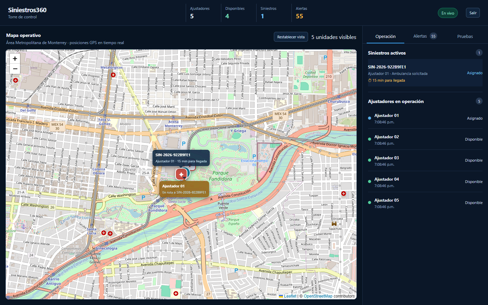
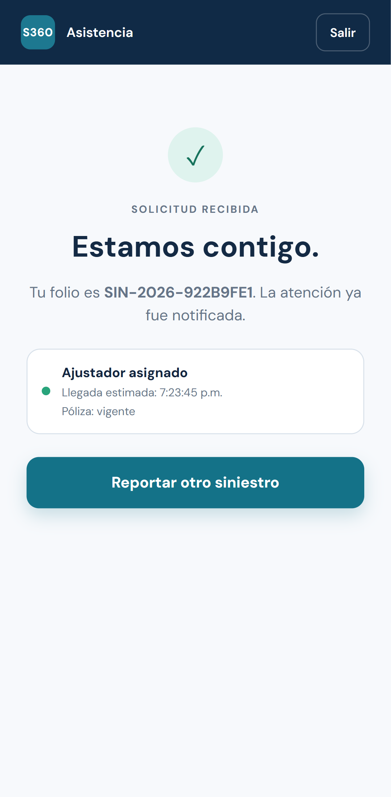
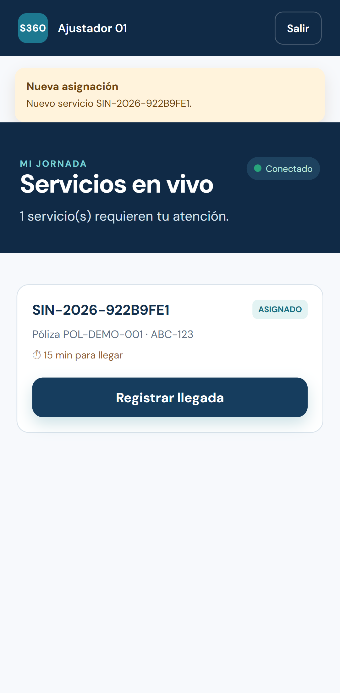
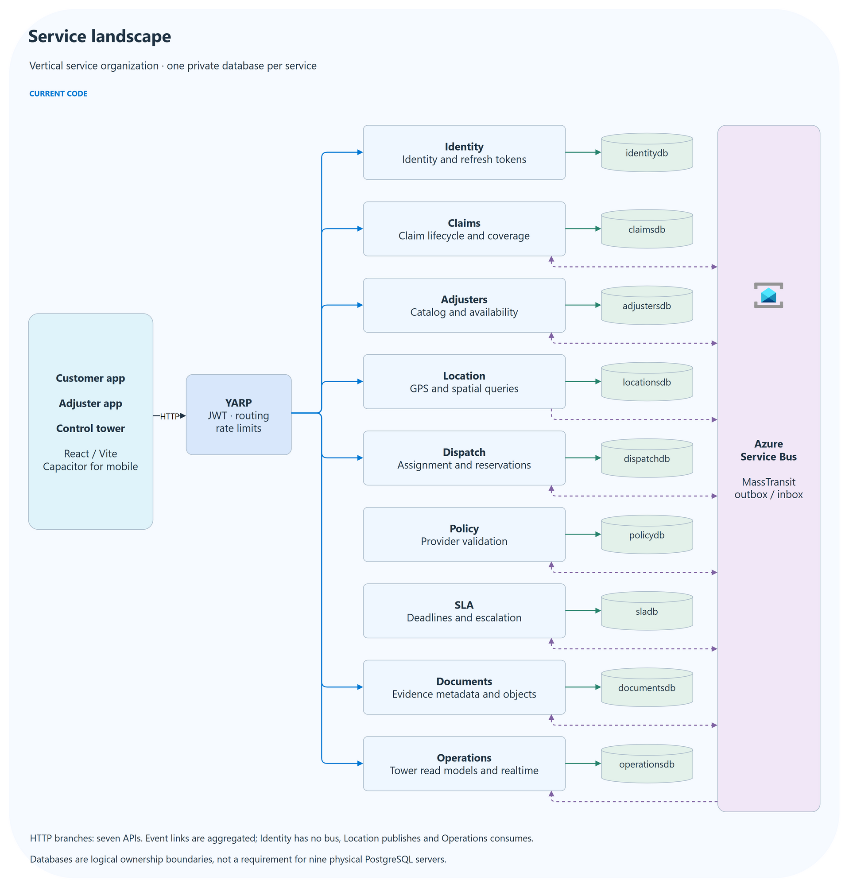
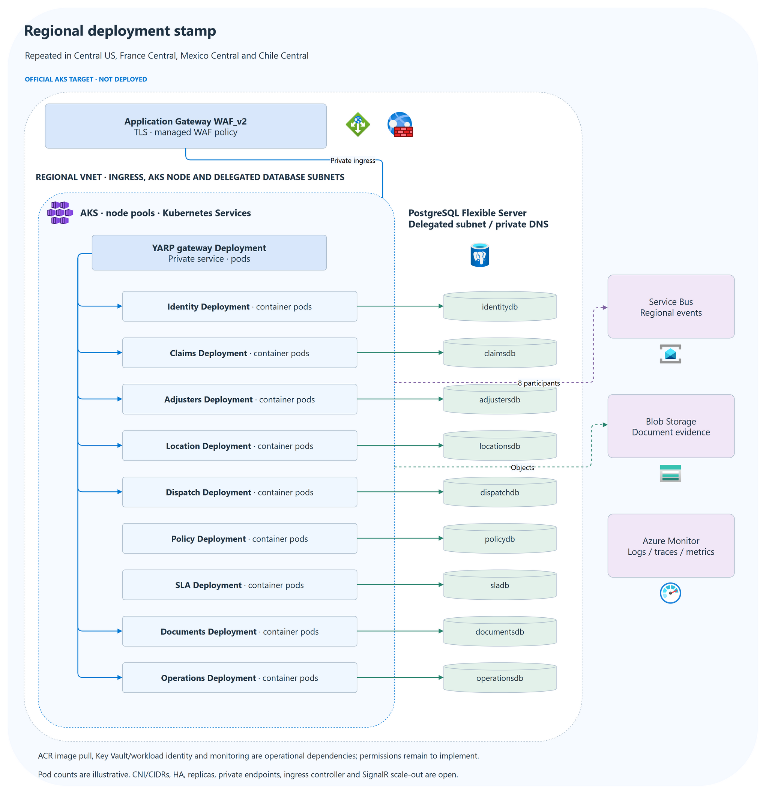
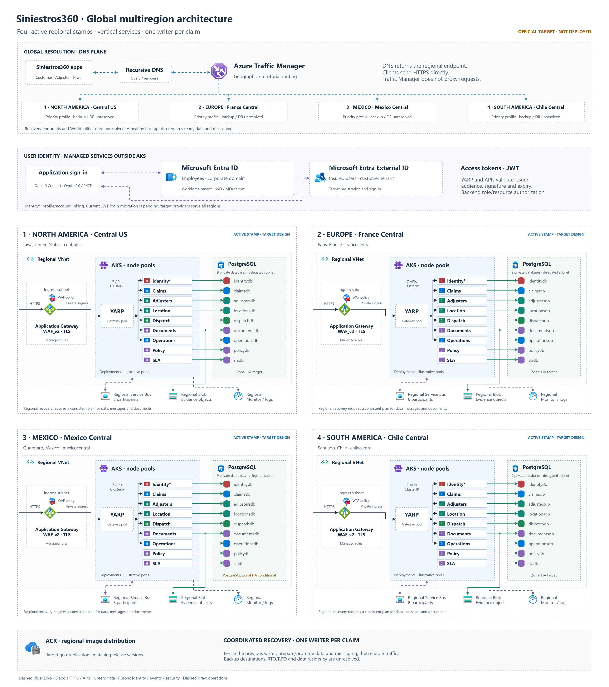
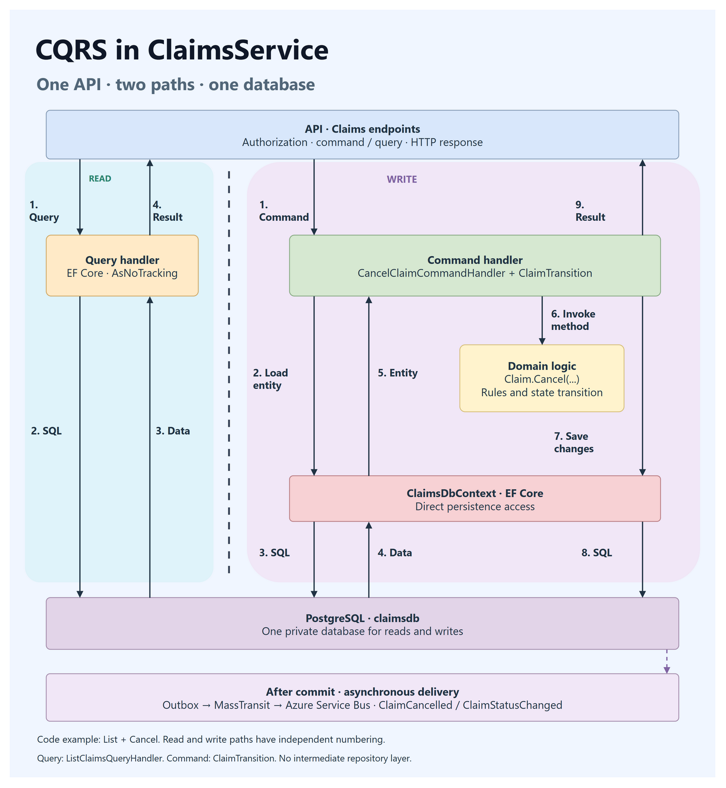
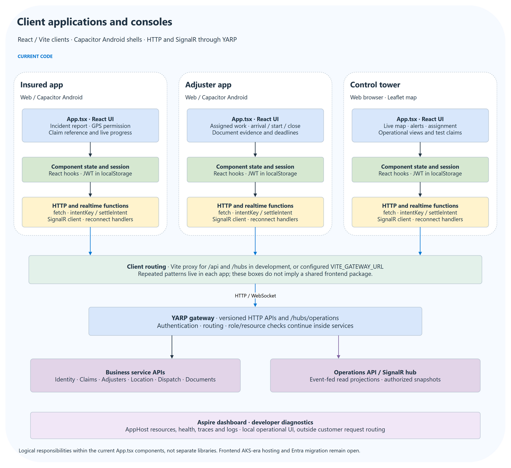
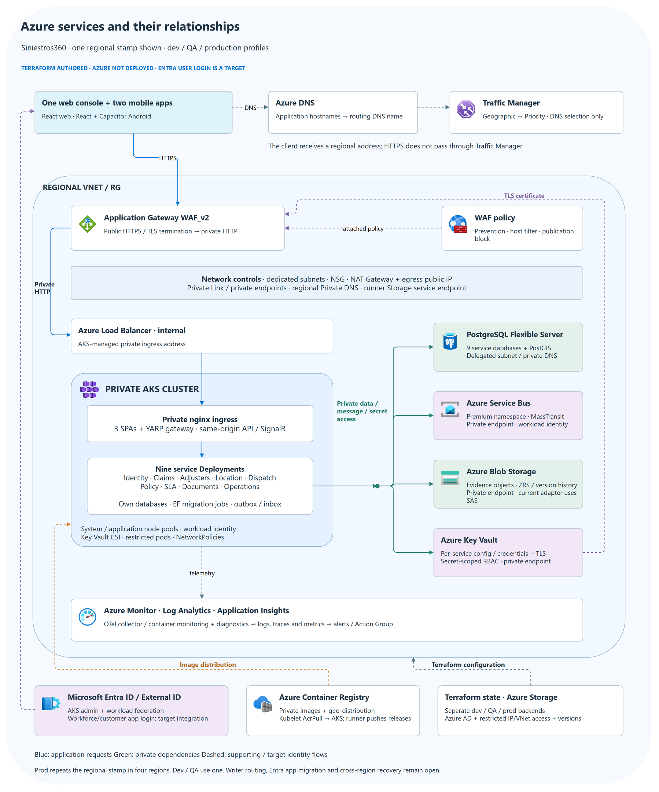

# Siniestros360

           

**Container tooling and Azure reference / IaC:**

    

Siniestros360 coordinates motor-insurance claims in real time for a single insurer. It connects the insured customer requesting help, the adjuster providing field service, and the control tower supervising the operation—from the first GPS incident report through assignment, evidence collection and service completion. Policy coverage is validated asynchronously so assistance can begin immediately.

The implemented demo combines .NET 10 microservices, Aspire, YARP, PostgreSQL/PostGIS, MassTransit over Azure Service Bus, SignalR and React/Vite. The product has **one web console and two mobile apps**. The mobile implementation is **React + Capacitor for Android**; React Native is not a dependency in this repository. The approved Azure scenario uses **AKS**, regional WAF and Entra registrations. Terraform is authored; Azure deployment and the application's Entra login migration are pending.

[Demo walkthrough](./handbook/demo.md) · [Public handbook](./handbook/README.md) · [Applications](#applications-one-web-console-and-two-mobile-apps) · [Architecture](#architecture-at-a-glance) · [Service internals](#internal-architecture-of-every-service) · [Azure components](#azure-components-and-their-purpose) · [Terraform and environments](#terraform-and-environments)

| User | Product capabilities |
|---|---|
| Insured customer | Report GPS, vehicle/policy details and ambulance need; receive an immediate reference and live progress. |
| Field adjuster | See assigned claims/deadlines, record arrival/start/completion and upload evidence. |
| Control tower / administrator | Monitor the live map, assignments and alerts; acknowledge alerts and request assignment/reassignment. |

## Applications: one web console and two mobile apps

| Application | Form factor and implemented stack | Purpose | Source |
|---|---|---|---|
| Control tower | **Web application** — React, TypeScript, Vite and map components | Operators monitor units/claims, assignments, arrival deadlines and alerts; acknowledge alerts and coordinate reassignment. | [control-tower](./apps/control-tower) |
| Insured customer | **Mobile app** — React, TypeScript and Capacitor Android; also runs in a browser | Customers report an incident with location/vehicle/policy details, receive a reference and follow assistance and coverage. | [insured-app](./apps/insured-app) |
| Field adjuster | **Mobile app** — React, TypeScript and Capacitor Android; also runs in a browser | Adjusters receive assignments, share location, record arrival/start/completion and upload evidence. | [adjuster-app](./apps/adjuster-app) |

Capacitor packages the React web UI in the native Android project under each mobile app's `android/` directory. An Android package does not make the UI React Native. A React Native rewrite would be a separate implementation change. No iOS project or physical-device validation is claimed here.

Historical demo captures from the existing end-to-end evidence. The product UI is Spanish for its Mexican operating context; documentation is English. These images are not evidence of a fresh test run or a cloud deployment.

### Web console — control tower

Live units, an assigned claim, map and arrival deadline.



### Mobile app — insured customer

Incident confirmation, assigned adjuster and asynchronous coverage result.



### Mobile app — field adjuster

New assignment, arrival deadline and the action to register arrival.



Screenshots and diagrams use standard Markdown image links and repository-local PNGs. Open an image for full resolution; editable diagram sources are linked in the [asset index](./assets/architecture/README.md).

## Architecture at a glance

Read the views from the whole system down to a service and its clients. The [diagram source index](assets/architecture/README.md) includes editable draw.io and SVG files. All images below live in publishable repository paths.

### 1. Services and data ownership

YARP fronts seven business APIs. Nine microservices own separate logical databases; Policy and SLA are event/worker-driven. MassTransit coordinates eventual updates with transactional outbox/inbox. Identity has no bus integration; Location publishes GPS events and Operations builds the read side.



### 2. Regional AKS deployment

Each target stamp places containerized service Deployments behind Application Gateway WAF_v2 and YARP. PostgreSQL databases sit outside AKS; Service Bus, Blob and monitoring are regional dependencies. Pod symbols do not prescribe replica counts.



### Global view — four regional stamps

Central US, France Central, Mexico Central and Chile Central are the selected scenario regions. Traffic Manager resolves regional endpoints through DNS; clients send HTTPS directly to the regional ingress. Safe regional recovery still requires data/message/object readiness and a single authorized writer.



### 3. Inside a service: Claims CQRS

Claims separates command and query handlers while using one database. The example shows List and Cancel, domain rules, EF Core and postcommit outbox delivery. Other services use patterns suited to their work: Dispatch has a persisted saga; Operations has event-fed projections. CQRS here does not imply event sourcing, two stores or a mediator.



### 4. Inside the apps and consoles

Each React app currently keeps its UI/workflow functions in App.tsx, with hooks for component state, a local JWT session, fetch-based HTTP, per-intent idempotency helpers and a SignalR client. These are logical responsibilities in the existing components, rather than a separate shared frontend architecture. Aspire's dashboard is a developer diagnostic console outside customer request routing.



## Internal architecture of every service

The trees below follow the existing code under [src/services](./src/services). `Program.cs` composes each executable; its own `Infrastructure/Migrations/` manages its service-owned PostgreSQL database. The connection names below match the local application; Terraform names the cloud databases `siniestros360_<service>`. Shared messaging adds transactional outbox/inbox where used. Separate folders express responsibilities; the services do not all implement the same CQRS pattern.

### Identity — ASP.NET Core Identity and token service

```text
Siniestros360.IdentityService/
├── Endpoints/AuthEndpoints.cs       Login, refresh and current-user HTTP endpoints
├── Application/TokenService.cs      JWT creation and refresh-token workflow
├── Domain/ApplicationUser.cs        User model and identity attributes
├── Infrastructure/IdentityData.cs   Identity DbContext, refresh-token data and demo seed
└── Infrastructure/Migrations/       Own database: identitydb
```

Identity currently issues HMAC JWTs and has no Service Bus integration. The Entra registrations in Terraform prepare the target federation; they do not replace this implementation.

### Claims — lightweight CQRS use cases

```text
Siniestros360.ClaimsService/
├── Endpoints/Claims/                Report, list, detail, arrival, start, complete and cancel
├── Application/Claims/
│   ├── Report/, RegisterArrival/    Commands, handlers and report validation
│   ├── StartService/, CompleteService/, Cancel/
│   ├── List/, GetById/              Queries and their handlers
│   └── Events/                     Assignment, coverage and escalation consumers
├── Application/ClaimsTelemetry.cs  Use-case instrumentation
├── Domain/Claim.cs, ClaimErrors.cs  Claim lifecycle, transitions and domain errors
└── Infrastructure/
    ├── ClaimsDbContext.cs          EF Core persistence and messaging transaction
    └── Migrations/                 Own database: claimsdb
```

Commands and queries share one database. Handlers use the DbContext directly; no repository layer, mediator, separate read database or event-sourced aggregate is implied.

### Adjusters — HTTP workflows and event consumers

```text
Siniestros360.AdjustersService/
├── Endpoints/AdjusterEndpoints.cs         Catalog, availability and status operations
├── Application/AdjusterEventsConsumer.cs Claim/assignment-driven status updates
├── Domain/Adjuster.cs                    Adjuster state and availability
└── Infrastructure/
    ├── AdjustersDbContext.cs             Service-local EF Core model
    └── Migrations/                      Own database: adjustersdb
```

### Location — geospatial ingestion and a timed worker

```text
Siniestros360.LocationService/
├── Endpoints/LocationEndpoints.cs   GPS ingestion and location queries
├── Application/
│   ├── LocationContracts.cs        Location input/output contracts
│   └── LocationEventSink.cs        Integration-event publishing boundary
├── Workers/GpsStaleWorker.cs       Detect stale positions
├── Domain/Locations.cs             Latest position and location history
└── Infrastructure/
    ├── LocationDbContext.cs        EF Core + PostGIS spatial persistence
    └── Migrations/                 Own database: locationsdb
```

Location publishes location/staleness events. Device capture time determines update ordering; the worker does not require another service's tables.

### Dispatch — persisted assignment saga

```text
Siniestros360.DispatchService/
├── Endpoints/DispatchEndpoints.cs          Manual assignment/reassignment requests
├── Application/
│   ├── AssignmentStateMachine.cs          Saga transitions, retries and compensation
│   ├── AdjusterReservations.cs            Reservation and candidate selection workflow
│   └── AdjusterProjectionConsumer.cs      Local adjuster/location projections
├── Domain/DispatchModels.cs               Saga state, attempts and request messages
└── Infrastructure/
    ├── DispatchDbContext.cs               Saga/reservation/projection persistence
    └── Migrations/                       Own database: dispatchdb
```

The saga coordinates services through messages and local projections. Reservation concurrency is local to Dispatch; global writer fencing is still a target requirement.

### Policy — event-driven provider integration

```text
Siniestros360.PolicyService/
├── Application/
│   ├── PolicyValidationConsumer.cs Requested-validation message workflow
│   └── PolicyProviderClient.cs     External provider adapter and resilience
├── Domain/PolicyValidation.cs      Validation result and state
└── Infrastructure/
    ├── PolicyDbContext.cs          Service-local validation persistence
    └── Migrations/                 Own database: policydb
```

Policy has no business REST API. It consumes requests, calls the configured provider and publishes the result asynchronously; assistance does not wait for coverage.

### SLA — event consumers and deadline monitoring

```text
Siniestros360.SlaService/
├── Application/
│   ├── SlaEventsConsumer.cs        Update tracking from lifecycle events
│   └── SlaPolicy.cs                Deadline and warning policy
├── Workers/SlaMonitoringWorker.cs  Detect warning/breach and publish escalation
├── Domain/SlaModels.cs             Tracking, alerts and alert types
└── Infrastructure/
    ├── SlaDbContext.cs             Service-local deadline persistence
    └── Migrations/                 Own database: sladb
```

SLA has no business REST API. Its background checks observe persisted deadlines and emit events instead of calling other databases.

### Documents — metadata, access projection and object storage

```text
Siniestros360.DocumentsService/
├── Endpoints/DocumentEndpoints.cs   Evidence upload, retrieval and soft deletion
├── Application/ClaimAccessConsumer.cs
│                                  Build local claim/resource-access information
├── Domain/DocumentModels.cs        Document metadata and claim-access projection
└── Infrastructure/
    ├── DocumentsDbContext.cs       Metadata/access persistence
    ├── Storage/ObjectStorage.cs    Local storage or Azure Blob adapter
    └── Migrations/                 Own database: documentsdb
```

Blob stores the file bytes; PostgreSQL stores metadata and authorization projections. The current Blob adapter uses a container SAS, so migrating it to workload identity remains application work.

### Operations — event-fed read models and realtime delivery

```text
Siniestros360.OperationsService/
├── Endpoints/
│   ├── OperationsQueries.cs        Tower snapshots and query endpoints
│   └── AlertCommands.cs            Alert acknowledgment and command endpoints
├── Application/
│   ├── OperationsProjectionConsumer.cs  Project lifecycle events
│   ├── AdjusterLocationConsumer.cs      Project GPS updates
│   └── Views.cs                         Read-view contracts/mapping
├── Hubs/OperationsHub.cs           Authorized SignalR groups and live delivery
├── Domain/ReadModels.cs            Claim, adjuster and alert projections
└── Infrastructure/
    ├── OperationsDbContext.cs      Local read-model persistence
    └── Migrations/                 Own database: operationsdb
```

Operations is a read-side service with command endpoints for operational actions. SignalR notifications can precede consumer commit; reconnect/snapshot behavior and scale-out still require care.

### Gateway and shared foundations

```text
src/gateway/Siniestros360.Gateway/   YARP routing, JWT checks, rate limits and CORS
src/shared/
├── Siniestros360.Contracts/        Versioned integration-message contracts
├── Siniestros360.SharedKernel/     Command/query contracts, Result and decorators
└── Siniestros360.Messaging/        MassTransit, outbox/inbox and HTTP idempotency
src/aspire/
├── Siniestros360.AppHost/          Local resource/service orchestration
└── Siniestros360.ServiceDefaults/  HTTP, authorization, health and OpenTelemetry
```

SharedKernel supports the Claims CQRS pilot; its existence does not mean every service uses command/query handlers. YARP has no business database. Aspire's dashboard is local developer tooling, not the Azure production control plane.

## Azure components and their purpose

This inventory describes resources authored in Terraform and AKS-managed components. The existing local demo uses a real development Service Bus namespace; the following AKS platform has **not been deployed**. Entra user login remains a target integration.



[Editable Azure relationship diagram](./assets/architecture/20-azure-components.drawio) · [SVG](./assets/architecture/20-azure-components.svg)

| Azure component | Purpose in Siniestros360 | Connection / owner |
|---|---|---|
| Resource Groups | Group lifecycle and ownership for state, global and regional resources. | Environment-specific Terraform roots. |
| Azure DNS public zone and CNAMEs | Publish `api`, `insured`, `adjuster` and `tower` hostnames. | Delegated child zone → Traffic Manager DNS name. |
| Traffic Manager Geographic + nested Priority profiles | Choose a regional entry through DNS and monitor endpoint health. | DNS response selects an Application Gateway; client HTTPS goes directly there. |
| Application Gateway WAF_v2 | Terminate public TLS, probe the private backend and forward HTTP traffic. | Public IP → private AKS LoadBalancer. |
| Web Application Firewall policy | Apply Prevention-mode managed rules, accepted hosts and the publication block. | Attached to each regional Application Gateway. |
| Public IP resources | Stable regional HTTPS entry addresses and outbound NAT addresses. | Separate entry and egress roles; AKS application ingress stays private. |
| Virtual Network and dedicated subnets | Separate AKS nodes, Application Gateway, PostgreSQL, private endpoints, load balancer and runners. | One independent VNet per stamp. |
| Network Security Group | Allow required Application Gateway listener/management traffic. | Application Gateway subnet. Pod traffic also has Kubernetes NetworkPolicies. |
| Azure Load Balancer, internal | Bridge Application Gateway to the private ingress pods. | Created by AKS for the internal Kubernetes `LoadBalancer` Service. |
| NAT Gateway | Provide controlled outbound source addresses for AKS nodes and runners. | Associated AKS/runner subnets; NAT is not an application firewall. |
| AKS and managed node pools | Run Docker images for nine services, YARP, three SPAs, ingress, migrations and telemetry. | Separate system/application pools; AKS manages underlying compute/network resources. |
| AKS Azure Policy add-on | Enable cluster policy integration. | Cluster configuration; a subscription-wide custom policy assignment is not supplied. |
| Azure Container Registry, Premium | Store private release images and distribute them to configured regions. | Private endpoints and kubelet `AcrPull`; builds push from an authorized private runner. |
| Azure Database for PostgreSQL Flexible Server | Persist each service's business data, saga or projections. | Delegated private subnet, one server per stamp and nine isolated logical databases; Location uses PostGIS. |
| Azure Service Bus, Premium in Terraform | Carry integration events for the eight messaging services. | MassTransit with Entra workload identity; outbox/inbox remains in PostgreSQL. |
| Azure Blob Storage, ZRS | Store evidence objects independently of pod lifetimes. | Documents service → private Blob endpoint; a separate account stores Terraform state. |
| Azure Key Vault | Store each service's configuration, database credentials, compatibility JWT/SAS and edge TLS certificate. | Workloads receive secret-scoped access; Application Gateway reads its certificate secret. |
| Private Link / private endpoints | Reach ACR, Blob, Service Bus and Key Vault through private addresses. | Four dependency endpoint types per regional VNet. PostgreSQL uses delegated networking instead. |
| Azure Private DNS zones and VNet links | Resolve private dependency names from the appropriate stamp. | Regional DNS links; AKS also manages its private API resolution. |
| Storage service endpoint on the runner subnet | Authorize cross-region Terraform backend access through a selected VNet rule. | `Microsoft.Storage.Global` → protected state account; distinct from Blob Private Link. |
| Microsoft Entra ID | Corporate workforce authentication target and AKS administrator access. | Workforce API/SPA/native registrations; current app JWT login still needs migration. |
| Entra External ID | Customer tenant and public-client registration target. | Optional tenant creation plus customer API/SPA/native registrations; user flows/policies need configuration. |
| User-assigned managed identities and workload federation | Give pods and the gateway identities without embedding Azure client passwords. | AKS OIDC service-account federation; separate cluster, workload and edge identities. |
| Azure RBAC role assignments | Limit who can pull images, manage topology, read secrets, operate AKS and access state. | Resource/secret-scoped grants; current MassTransit topology creation requires Service Bus Data Owner. |
| AKS Key Vault Secrets Store CSI add-on | Mount service configuration into pods from Key Vault. | SecretProviderClass + workload identity; config-version rollouts handle `subPath` rotation. |
| Azure Monitor and diagnostic settings | Collect supported platform logs/metrics from authored resources. | Regional monitoring pipeline. |
| Log Analytics workspace | Store/query platform and container logs. | Regional diagnostic destinations and AKS container monitoring. |
| Application Insights | Receive application traces, metrics and logs. | OpenTelemetry collector → regional Azure Monitor ingestion. |
| Monitor metric alerts and Action Groups | Notify operations about database CPU, dead letters and unhealthy ingress. | Metric rules → configured operations email. |
| Azure Storage backend for Terraform | Keep state, locking/version history and deployment metadata outside workstations. | Separate environment account, Azure AD access and restricted IP/VNet rules. |

The diagram separates request traffic, private data/message access, image delivery and supporting identity/telemetry. It does not imply that Traffic Manager proxies HTTPS, that PostgreSQL uses a private endpoint, or that Entra already authenticates the current clients. The Azure roles follow the [Microsoft AKS microservices reference](https://learn.microsoft.com/en-us/azure/architecture/reference-architectures/containers/aks-microservices/aks-microservices) and [Traffic Manager's DNS model](https://learn.microsoft.com/en-us/azure/traffic-manager/traffic-manager-overview), with the repository's actual Terraform choices recorded above.

## Terraform and environments

The infrastructure has **seven deployment stages**, **three reusable modules**, migration/backend/SPA container recipes, a 22-image release planner and credential-free validation CI. [Deployment guide](./infrastructure/terraform/README.md) · [Coverage](./infrastructure/terraform/coverage.json) · [Validation evidence](./infrastructure/terraform/VALIDATION.md).

```text
infrastructure/
├── terraform/
│   ├── bootstrap/                 Protected Azure Storage state backend
│   ├── platform/                  ACR and private regional AKS/data/network stamps
│   ├── tenant/                    Optional External ID customer tenant
│   ├── identity/                  Environment-specific API/SPA/native registrations
│   ├── regional-data/             Service database grants, PostGIS, secrets and TLS
│   ├── workloads/                 Migrations, services, apps, private ingress and telemetry
│   ├── edge/                      WAF, Application Gateway, DNS and Traffic Manager
│   ├── modules/                   regional, identity and edge building blocks
│   └── environments/
│       ├── dev/                   Development inputs and independent backend keys
│       ├── qa/                    QA inputs and independent backend keys
│       └── prod/                  Four-region production-scenario configuration
├── containers/                    Backend, EF migration and SPA Docker recipes
└── scripts/                       Image planning and infrastructure checks
```

| Environment | Profile created in this repository | Regional network | Application host examples | Azure deployment |
|---|---|---|---|---|
| Development (`dev`) | [Dev configuration](./infrastructure/terraform/environments/dev/README.md) | Mexico Central, `10.50.0.0/16` | `insured.dev.claims.example.com`, `adjuster.dev…`, `tower.dev…`, `api.dev…` | Not executed |
| Quality assurance (`qa`) | [QA configuration](./infrastructure/terraform/environments/qa/README.md) | Mexico Central, `10.60.0.0/16` | `insured.qa.claims.example.com`, `adjuster.qa…`, `tower.qa…`, `api.qa…` | Not executed |
| Production scenario (`prod`) | [Production configuration](./infrastructure/terraform/environments/prod/README.md) | Central US `10.40.0.0/16`, France Central `10.41.0.0/16`, Mexico Central `10.42.0.0/16`, Chile Central `10.43.0.0/16` | `insured.claims.example.com`, `adjuster.claims…`, `tower.claims…`, `api.claims…` | Not executed |

Each profile includes all seven roots, explicit regions, registration prefixes, DNS examples and a backend example per global/regional state. State accounts/keys, regional databases, identities and networks are separated by environment; the region is also part of data/workload state keys. The Kubernetes namespace stays `siniestros360` within separate clusters to match workload-federation subjects. Deploy release images by immutable tag/digest and promote the same artifact from QA to prod rather than rebuilding it.

All profiles keep public traffic **disabled at WAF and Traffic Manager**. Supply real subscription/tenant/group IDs, unique state-account names, a controlled domain, trusted TLS certificates, image releases and fresh SAS dates before a real plan. Dev/QA cloud profiles are single-region integration environments; local Aspire remains the workstation development path. Node/database/Premium service sizing uses the existing reference baseline and is not a validated low-cost preset. The ASP.NET runtime remains `Production` in cloud profiles; OpenTelemetry's deployment label distinguishes `dev`, `qa` and `prod`.

[Environment setup and promotion](./infrastructure/terraform/environments/README.md) documents backend selection, private runners, per-region ordering, QA acceptance and the production-readiness gates. Profiles are created and documented as source configurations; they are not claims that Azure resources or production HA have been provisioned.

## A claim through the system

1. The customer reports an incident; Claims commits its reference, state and event without waiting for coverage.
2. Dispatch consumes the event, reserves an eligible adjuster and starts independent policy validation.
3. SLA tracks deadlines; Operations projects the event stream and pushes authorized SignalR snapshots.
4. The adjuster records arrival, uploads evidence and completes service; the matching reservation is released.
5. An arrival breach can trigger reassignment and compensation. No available replacement keeps the current assignment and alerts the tower.

## Services and repository

Identity owns users/tokens; Claims owns claim state/coverage; Adjusters owns catalog/availability; Location owns GPS/PostGIS; Dispatch owns the persisted assignment saga/reservations; Policy owns resilient provider validation; SLA owns deadlines; Documents owns metadata/objects; Operations owns read views/SignalR. YARP is the app entry point. Each service has its own database/migrations and never queries another service's tables.

| Folder | Contents |
|---|---|
| src/aspire | AppHost local topology; shared telemetry, health, HTTP and security defaults |
| src/shared | Contracts, SharedKernel CQRS/Result, Messaging/outbox/inbox/idempotency |
| src/gateway | YARP gateway |
| src/services | Nine executables with HTTP endpoints where applicable, application/domain/infrastructure code and Dockerfiles |
| src/tools | Local GPS simulator |
| apps | insured-app, adjuster-app and control-tower; first two support Capacitor Android |
| tests | Unit, contract, architecture, integration, simulator and Playwright suites |
| docs | English design, official diagrams, evidence, decisions and operations |
| infrastructure | Terraform roots/modules, dev/qa/prod profiles, container recipes and checks |

The [public handbook](./handbook/README.md) publishes the curated design, decision register, local demonstration, validation and limitations. Private workspace notes under docs/ remain outside Git. Images, editable diagram sources and historical screenshots are published under assets/. [Code organization](src/README.md) describes the implementation.

## HTTP versions and authorization

Business APIs publish /api/v1 for auth, claims, adjusters, locations, dispatch/claims, documents and operations. The simulator exposes /api/v1/simulator. Gateway routing preserves the version; services decide support and publish per-version OpenAPI in Development. ApiVersions.V1 owns the major version. Compatible changes remain v1; incompatible route/required-field/semantic/status changes require a new major version, overlap/contract validation and a communicated retirement date. HTTP versions are independent of Git releases and event versions.

Health/alive, gateway/info, SignalR hubs and the simulator landing page are operational surfaces outside the REST version contract. Policy/SLA have no business REST API. All endpoints are authenticated unless explicitly anonymous. Named role/resource policies enforce ownership inside services.

## Requirements

- .NET 10 SDK; Node.js 22; Docker Desktop for local PostgreSQL and integration tests.
- A real Azure Service Bus Standard namespace for development: Basic lacks topics. The repository's MassTransit/emulator configuration cannot use the emulator's split administration/messaging ports. Local docs/service-bus.md explains the transport decision.

## Declared dependency versions

The table records repository declarations, not claims about the latest vendor release. Directory.Packages.props owns NuGet versions; app package.json/package-lock.json own JavaScript versions.

| Component | Declared version |
|---|---|
| .NET / ASP.NET Core / EF Core | 10 / 10.0.11 / 10.0.11 |
| .NET Aspire | 13.5.4 |
| PostgreSQL/PostGIS (local image) | 16-3.4 |
| API versioning (`Asp.Versioning.Http`, `OpenApi`) | 10.2.3 |
| YARP / Service Discovery | 2.3.0 / 10.8.0 |
| HTTP resilience (`Microsoft.Extensions.Http.Resilience`) | 10.8.0 |
| MassTransit and Azure Service Bus transport | 8.5.11 |
| Npgsql EF Core / PostGIS | 10.0.3 |
| Scrutor / FluentValidation | 7.0.0 / 12.1.1 |
| OpenTelemetry SDK and OTLP exporter | 1.15.3 |
| React / Vite / TypeScript | ^19.2.8 / ^8.2.2 / ~6.0.2 |
| Capacitor Android / SignalR JavaScript | ^8.5.1 / ^10.0.11 |
| xUnit / Testcontainers PostgreSQL / Playwright | 2.9.3 / 4.15.0 / ^1.63.0 |

## Local startup

Follow the [local demonstration guide](./handbook/development.md), including explicit demo opt-in, a caller-provided password and an isolated development broker. Keep connection strings out of the repository.

```powershell
dotnet user-secrets set "Parameters:jwt-signing-key" "<at-least-32-character-key>" --project src/aspire/Siniestros360.AppHost
dotnet user-secrets set "ConnectionStrings:servicebus" "<namespace-connection-string>" --project src/aspire/Siniestros360.AppHost
# Demo:Enabled and Parameters:demo-password must be configured explicitly; see handbook/development.md.
aspire run
# Alternative:
dotnet run --project src/aspire/Siniestros360.AppHost
```

| Resource | Local URL |
|---|---|
| Aspire dashboard | https://localhost:17025 |
| Gateway | http://localhost:5090 |
| Customer app | http://localhost:5173 |
| Adjuster app | http://localhost:5174 |
| Control tower | http://localhost:5175 |

Local demo accounts are provisioned by the Identity service seed. Keep their credentials out of published documentation and do not provision those accounts in an environment accepting public traffic. Stop unused AppHost/simulation to avoid broker usage. Dockerfiles build from the repository root, for example `docker build -f src/services/Siniestros360.ClaimsService/Dockerfile .`.

## Validation and concepts

[Testing guide](tests/README.md) provides project commands; [public validation notes](./handbook/validation.md) distinguish historical evidence from current GitHub runs. CI builds the solution/apps, checks formatting and runs focused tests; browser e2e requires SERVICEBUS_CONNECTION_STRING. Documentation/media changes are checked through local links, source correspondence and actual diagram exports rather than repeating application tests.

Demonstrated code concepts: bounded-context microservices, asynchronous integration, outbox/inbox, saga compensation, transactional HTTP idempotency, JWT/RBAC/resource ownership, PostGIS, SignalR groups, deadlines, provider resilience, OpenTelemetry, ProblemDetails, lightweight CQRS in Claims and contract testing. AKS, multiregion ownership/recovery and Entra federation are official target design concepts, not implemented runtime claims.

## Security & Infrastructure Delivery

Current application controls include authenticated-by-default APIs, role/resource authorization, user-scoped idempotency, input validation and externalized secrets. The target adds federated identity and managed cloud boundaries; the current clients still use localStorage tokens and require a session-storage review during migration.

The [Terraform implementation](infrastructure/terraform/README.md) now supplies seven deployment stages and three reusable modules for the approved AKS scenario: protected state, private ACR, four regional stamps, Entra registrations, isolated service databases/secrets, Kubernetes workloads and WAF/Traffic Manager/DNS. It includes migration/SPA/backend container recipes, configuration examples and credential-free CI checks. See [architecture-to-code coverage](infrastructure/terraform/coverage.json) and [validation evidence](infrastructure/terraform/VALIDATION.md). The code is authored and locally checked; no real Azure plan, deployment or recovery drill has run.

Before publication, resolve RTO/RPO and recovery destinations, residency/retention, subscription capacity, Entra account/role migration, previously persisted demo accounts, home-region routing/fencing and SignalR scale-out. Public traffic is disabled at both WAF and Traffic Manager by default. The three SPAs have a private AKS hosting recipe; backend replication and cross-region data recovery remain application/operational work.

## License and contributions

Original code/documentation is available under the [MIT License](./LICENSE). See [contributing](./CONTRIBUTING.md), [security reporting](./SECURITY.md), [third-party notices](./THIRD_PARTY_NOTICES.md) and the [v0.1.0 changelog](./CHANGELOG.md). This is a demonstration release; [known limitations](./handbook/known-limitations.md) are part of its published scope.
